<p align="center">
  
</p>

<p align="center">
  <a href="https://rill-cmd.github.io"></a>
  
</p>


```yaml
role:       Computer Science student
education:  BS Computer Science, specialization in Software Engineering, FEU Tech
location:   Manila, Philippines
languages:  Python, TypeScript
focus:      FastAPI, multi-agent tooling, edge computer vision, Raspberry Pi / Arduino
current:    Building the Ascend project series
```

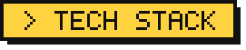

<p>
  
  
  
  
  
  
  
  
  
  
  
  
  
</p>

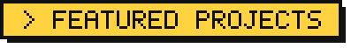

<p>
  <a href="https://github.com/RIll-cmd/ascend-hub">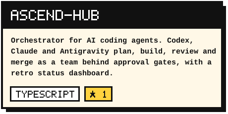</a>
  <a href="https://github.com/RIll-cmd/ascend-core">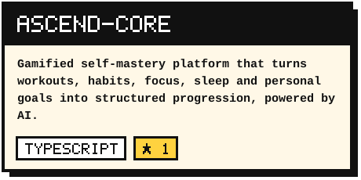</a>
  <a href="https://github.com/RIll-cmd/ascend-vision">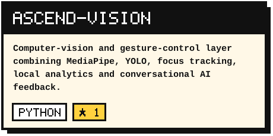</a>
  <a href="https://github.com/sutayniee/Wake-Brake">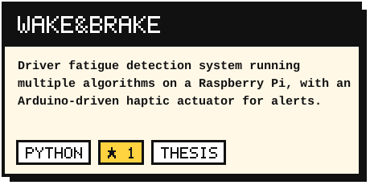</a>
  <a href="https://github.com/RIll-cmd/Kinsenas-Collection-Agent">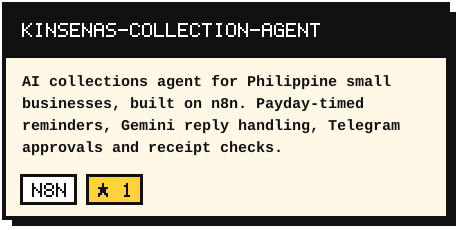</a>
  <a href="https://github.com/RIll-cmd/prescriptive-finance">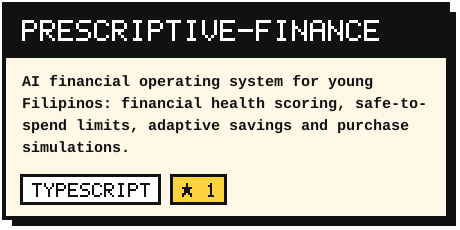</a>
</p>

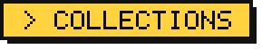

<p>
  <a href="https://github.com/stars/RIll-cmd/lists/flyrank">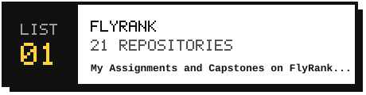</a>
  <a href="https://github.com/stars/RIll-cmd/lists/projects-prototypes">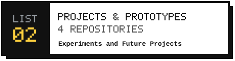</a>
  <a href="https://github.com/stars/RIll-cmd/lists/software-engineering-showcase">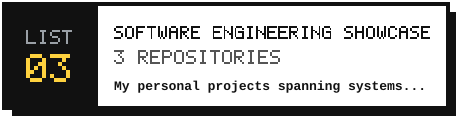</a>
  <a href="https://github.com/stars/RIll-cmd/lists/thesis">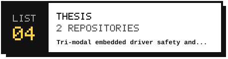</a>
</p>

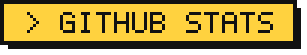

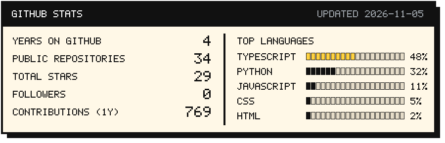

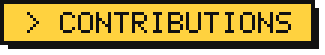

<picture>
  <source media="(prefers-color-scheme: dark)" srcset="https://raw.githubusercontent.com/RIll-cmd/RIll-cmd/output/snake-dark.svg">
  
</picture>

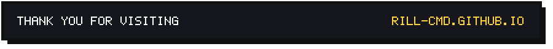
